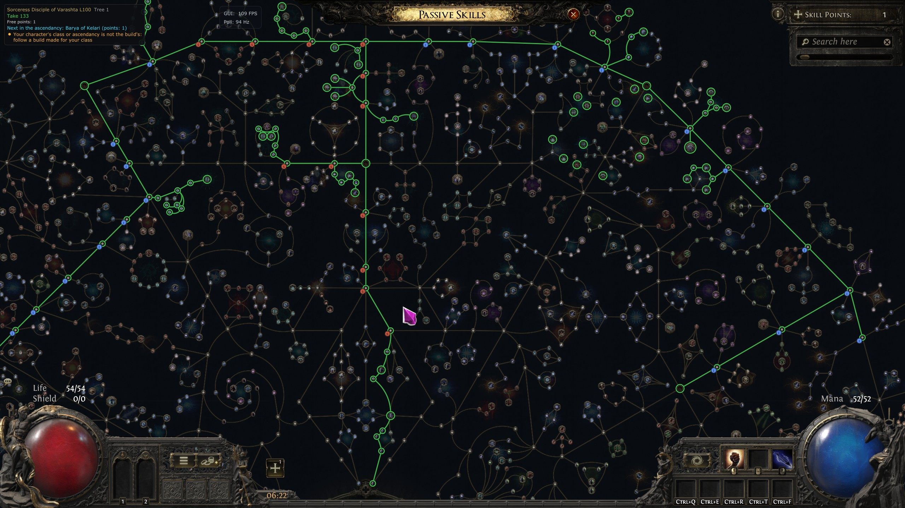
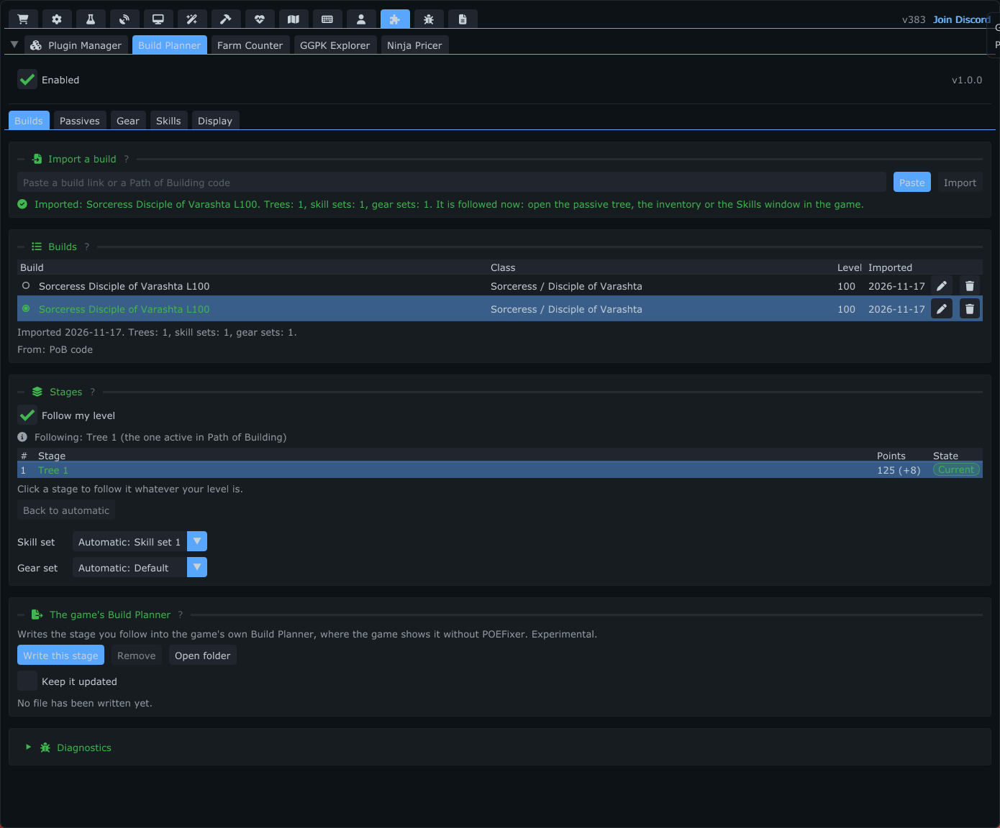
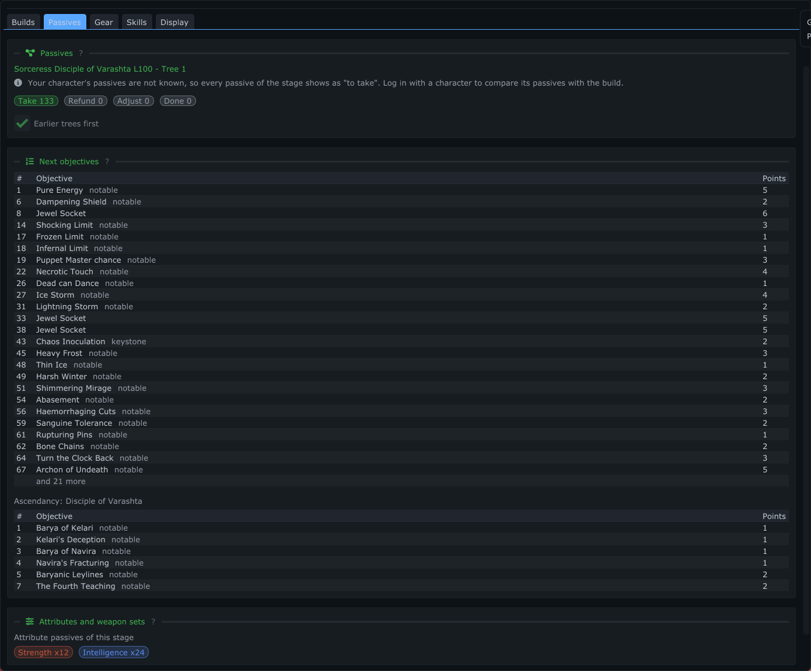
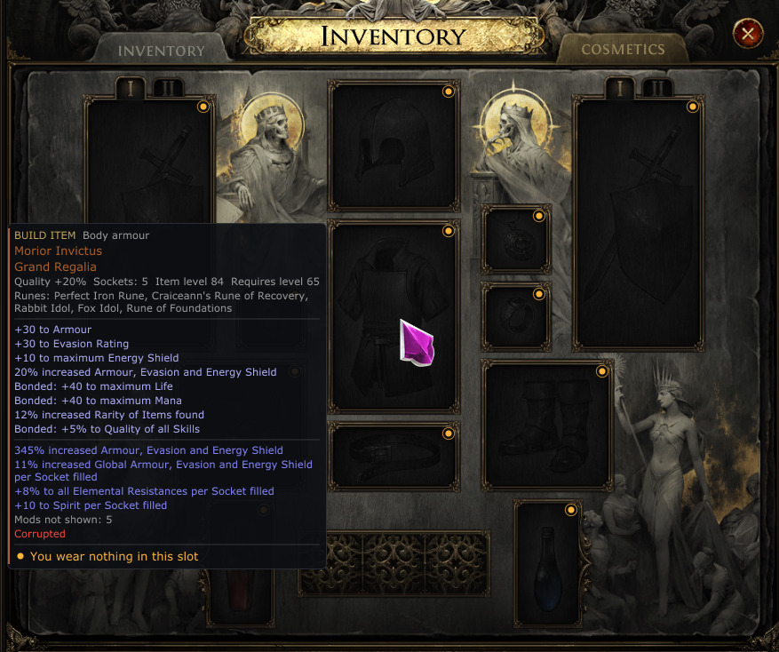
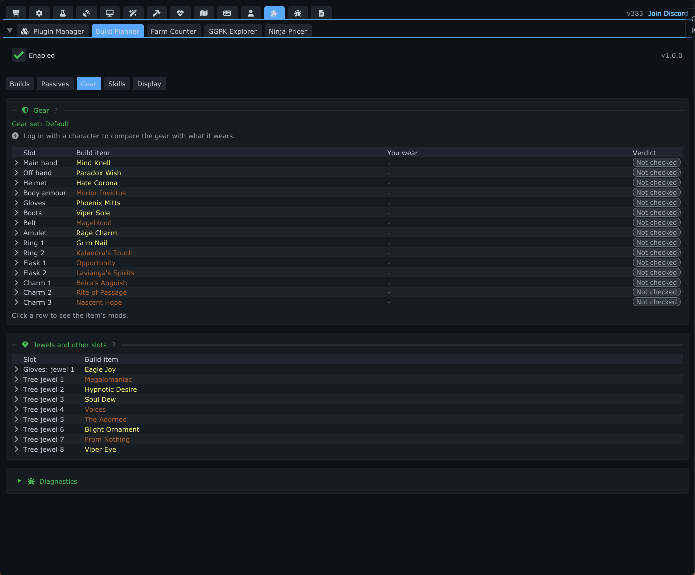
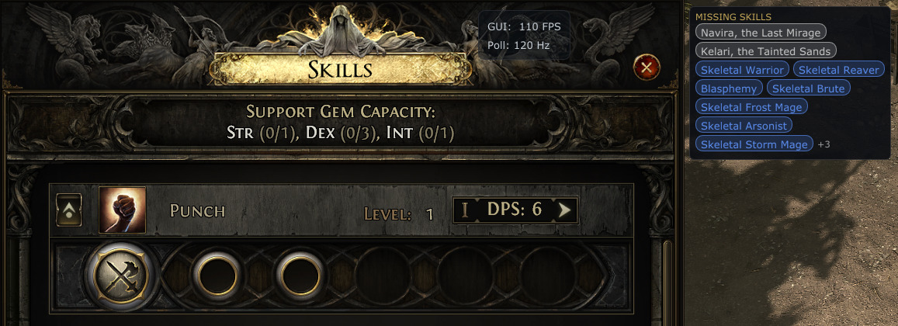
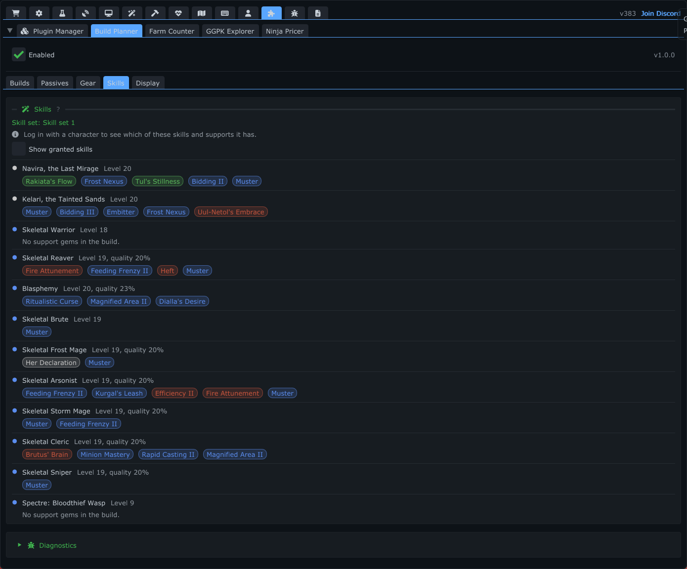

# Build Planner

Current version: 1.0.0

Requires POE2Fixer 366 or newer.

Shows a Path of Building build inside Path of Exile 2, where you need it:

- on the **passive tree**: which points to take next, numbered in a real order, what to refund, and which
  points the build takes with Weapon Set I or II or with another attribute than you chose;
- on your **equipment**: hover a slot in the inventory to see the item the build wears there, next to the game's
  own tooltip, and a small mark on every slot that tells whether you already wear it;
- on your **skills**: every skill of the build with its support gems, as marks on the game's Skills window
  and in a window of its own.

Build Planner only reads the game and draws on top of it. It never clicks, never presses a key and never
changes your character.

## Importing a build

Open the plugin's **Builds** tab and paste one of these (the Paste button reads the clipboard for you):

- a link to a build: `pobb.in`, `poe.ninja/poe2/pob/...`, `maxroll.gg/poe2/pob/...`, `poe2db.tw/pob/...`,
  `pastebin.com`, or a character page of the poe.ninja builds ladder;
- a build code exported from Path of Building (PoE2): *Import/Export Build -> Generate -> Copy*;
- the XML of a Path of Building build.

The build is imported at once and its hints show right away: no restart is needed. A Maxroll build guide is
not a build by itself: open the guide's Path of Building link (`maxroll.gg/poe2/pob/...`) and paste that one.

Imported builds stay in the list until you delete them. Click a build to follow it; rename it to tell your
builds apart.

Build Planner uses the internet only when you import a link or press **Update tree data**. It sends nothing
about you or your character.

### Leveling builds

A build can hold several stages: a passive tree for each part of the leveling, each with its own skills and
gear. Build Planner follows the stage that fits your character by itself: by the level range in the stage's
name ("Lvl 20-40") when the author wrote one, otherwise the first stage you have not finished. Click a stage to
stay on it, and pick another skill set or gear set when you want to look ahead.

## What you see

### Passive tree

Open the game's passive tree:

- a **green ring** is a point the build has and you do not; the **numbers** are the order to take them in, and
  the bright ring with **1** is the next point;
- a **red ring** is a point you have and the build does not: refund it;
- an **orange ring** is a point you took in another way than the build: with another weapon set, or with
  another attribute on a "+5 to any Attribute" point. A small **I** / **II** or **S** / **D** / **I** badge says
  what the build wants;
- the box at the top left sums it up: how many points to take, refund and adjust, your free points, and the
  next notable or keystone with its cost;
- move the cursor over a ring to read what to do with that point and what it leads to.

The **Passives** tab shows the same as a list, also while the game is closed: the next objectives in order with
their cost in points, the ascendancy, and the attribute and weapon set choices of the build.

### Equipment

Open the inventory. A green tick on a slot means you wear the build's item, an amber dot means the build has
another item for that slot. Hover the slot to see the build's item with its mods beside the game's tooltip.
The **Gear** tab lists the whole gear set for reading outside the game. A unique item must be the same unique;
a rare or magic item is compared by its base type ("Same base"), and its mods are yours to compare. The
item card over the game says it the same way: "You wear this item", or "Same base type" with the name of
the item you wear.

### Skills and support gems

On the game's Skills window every support socket gets a mark: a green tick when that support is in the build,
an amber arrow when the build uses another tier of it, a red cross when it is not in the build; beside the skill
the plugin names the supports that are still missing.
Skills of the build that your character does not have yet are listed in a **Missing skills** card beside
the window.

The **Build skills** window lists every skill of the build with its support gems, and ticks what your
character already has. It stays closed until you open it: give it a key on the **Display** tab, or press the
button there. You can also let it open together with the game's Skills window, or keep it always on screen.
The **Skills** tab lists the same outside the game.

### The game's own Build Planner

Path of Exile 2 has a Build Planner of its own that shows builds from files. On the **Builds** tab you can
write the stage you follow as such a file ("POEFixer - <build name>"), keep it updated, and remove it again.
Build Planner only ever touches the files it wrote itself. This keeps working right after a game patch, when
the overlay may need an update first.

## Settings

The **Display** tab switches every part on and off and sets the number of step numbers, the width of the
lines and of the rings' outline, the ring size, the colours and the card opacity. Each tab ends with a **Diagnostics** card: it shows what the
plugin sees and holds **Update tree data** for the days after a game patch.

Passive tree and gem data come from Path of Building Community (PoE2); see `THIRD_PARTY_NOTICES.md`.

## Install

Install it from POE2Fixer → Plugins → Plugin Manager (one click, updates included), or download `BuildPlanner.zip` from [Releases](https://github.com/POEFixer/BuildPlanner/releases/latest) and extract it into the POE2Fixer folder (it creates `Plugins\BuildPlanner\`). Then enable the plugin in the Plugins tab.

## Build from source

This repository is the plugin folder from the POE2Fixer source tree (`Plugins/BuildPlanner/`) together with the host files it compiles against, kept at the same relative paths:

- `POEFixer/plugin_sdk/` - the POE2Fixer Plugin SDK v6 headers (`PluginAbi.h`, `PluginSDK.h`)
- `POEFixer/imgui/` - the Dear ImGui sources the DLL compiles against
- `tools/plugin_i18n/gen.py` - the translation tool: after editing `Plugins/BuildPlanner/lang/en.json` run `python tools/plugin_i18n/gen.py Plugins/BuildPlanner` (it rewrites the embedded English header); `--gate` checks every language file and the keys the sources use

1. Install Visual Studio 2022 with the "Desktop development with C++" workload (MSVC v143, Windows 10/11 SDK).
2. Open `BuildPlanner.sln`, select **Release | x64** and build the solution.
3. The plugin is written to `x64\Release\Plugins\BuildPlanner\BuildPlanner.dll` (Release builds carry no debug information, see `Directory.Build.targets`).
4. Copy `BuildPlanner.dll` into `Plugins\BuildPlanner\` next to the POE2Fixer executable, together with `Plugins\BuildPlanner\data`, `Plugins\BuildPlanner\lang` from this repository (same folder names).
